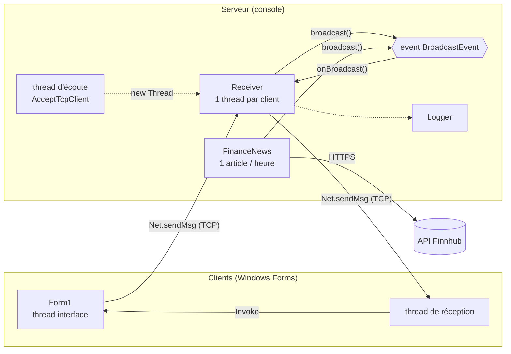

# FinChat

Application de chat **client–serveur en C#** (.NET Framework 4.8, TCP, threads, delegates/events), réalisée pour le projet du cours *Interface dev* (EFREI, ING2).

Elle part du squelette **DistantCalculator** fourni par le professeur et ajoute un channel **#finance** qui reçoit automatiquement un article financier toutes les heures (API Finnhub).

<!-- Décommenter quand la capture est ajoutée dans docs/screenshots/ :

-->

---

## Fonctionnalités

**Serveur** (console)
- Démarrer / arrêter le serveur (`start`, `stop`, `exit`)
- Plusieurs clients en même temps (1 thread par client)
- Login par pseudo (pseudo unique)
- Liste des clients connectés
- Diffusion des messages à tous les clients **avec un event (delegates)**
- Messages privés
- 2 channels : `#general` et `#finance`
- Article financier automatique dans `#finance` (1 par heure)
- Logs dans la console et dans `server_log.txt` (connexions, déconnexions, messages, erreurs)

**Client** (Windows Forms)
- Connexion au serveur avec un pseudo
- Messages publics et privés
- Choix du channel
- Liste des connectés (double-clic = message privé)
- Commandes : `/msg`, `/name`, `/users`, `/join`, `/quit`, `/help`

---

## Lancer le projet

**Prérequis :** Windows, [SDK .NET](https://dotnet.microsoft.com/download) (pour la commande `dotnet`), .NET Framework 4.8 (déjà présent sur Windows 10/11).

1. **Clé API Finnhub** (gratuite sur [finnhub.io](https://finnhub.io)) : copier `finnhub_key.example.txt` en `finnhub_key.txt` et y coller la clé.
   Ce fichier n'est jamais envoyé sur GitHub. Sans clé, le chat marche quand même, seul `#finance` est désactivé.

2. **Serveur** : double-clic sur `start-server.bat`, ou :
   ```
   dotnet run --project ChatServer
   ```

3. **Clients** (un par fenêtre) : double-clic sur `start-client.bat`, ou :
   ```
   dotnet run --project ChatClient
   ```

---

## Commandes du chat

| Commande | Effet |
|---|---|
| `texte` | message public dans le channel actuel |
| `/msg pseudo texte` | message privé |
| `/name nouveau` | changer de pseudo |
| `/users` | liste des connectés |
| `/join general` ou `/join finance` | changer de channel |
| `/quit` | quitter le chat |
| `/help` | afficher l'aide |

Commandes de la **console du serveur** : `start`, `stop`, `exit`.

---

## Architecture



| Projet | Type | Rôle |
|---|---|---|
| `Communication` | bibliothèque | Messages `[Serializable]` + `Net.sendMsg / rcvMsg` (repris du squelette) |
| `ChatServer` | console | Serveur, 1 `Receiver` par client, event de diffusion, thread finance, logs |
| `ChatClient` | Windows Forms | Fenêtre de chat, thread de réception, affichage avec `Invoke` |

Détails : [docs/ARCHITECTURE.md](docs/ARCHITECTURE.md)

---

## Documentation

| Document | Contenu |
|---|---|
| [docs/ARCHITECTURE.md](docs/ARCHITECTURE.md) | Schémas : vue d'ensemble, classes, trajet d'un message, threads |
| [docs/GUIDE.md](docs/GUIDE.md) | Carte du code : quel fichier, quelle méthode pour chaque fonction |
| [docs/TESTS.md](docs/TESTS.md) | Plan de test et résultats |
| [docs/RAPPORT.md](docs/RAPPORT.md) | Documentation à rendre (architecture, implémentation, captures) |
| [docs/COURS.md](docs/COURS.md) | Le cours relié au code, chapitre par chapitre, avec les questions possibles à l'oral |
| [docs/JUSTIFICATIONS.md](docs/JUSTIFICATIONS.md) | Chaque choix du code justifié par une slide du cours, expliqué pour débutant |

---

## Structure

```
FinChat/
├── Communication/        bibliothèque partagée (messages + Net)
├── ChatServer/           serveur console
├── ChatClient/           client Windows Forms
├── docs/                 documentation + captures d'écran
├── start-server.bat      lance le serveur
├── start-client.bat      lance un client
└── finnhub_key.example.txt
```

---

## Choix techniques

- **.NET Framework 4.8** et non .NET 10 : le `BinaryFormatter` du squelette a été supprimé de .NET 9/10.
- **Serveur sur 127.0.0.1** comme dans le cours : clients sur le même PC. Pour plusieurs PC, remplacer par `IPAddress.Any` dans `Server.start()`.
- **Seule partie hors cours** : la requête HTTP et la lecture du JSON de l'API, isolées dans `FinanceNews.cs`.

---

## Auteurs

Projet réalisé en binôme : Victor Haegeman et *(binôme)* — EFREI, ING2, cours Interface dev.
