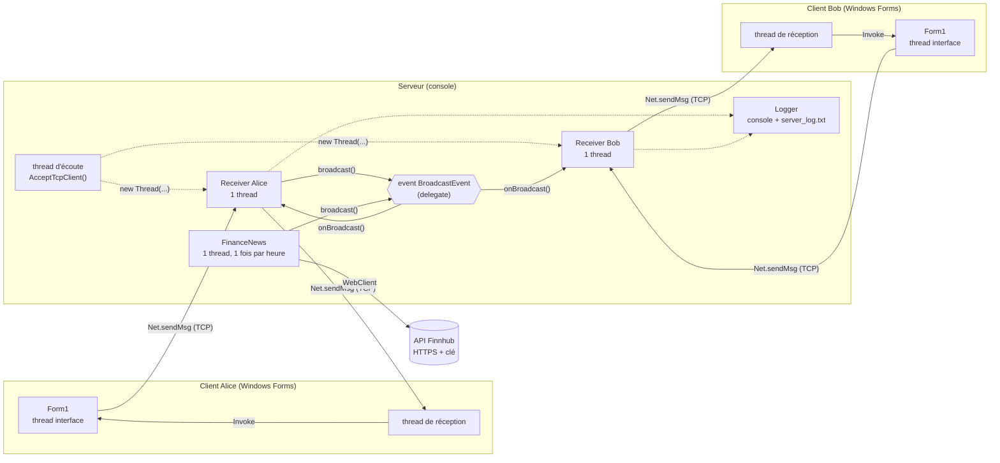
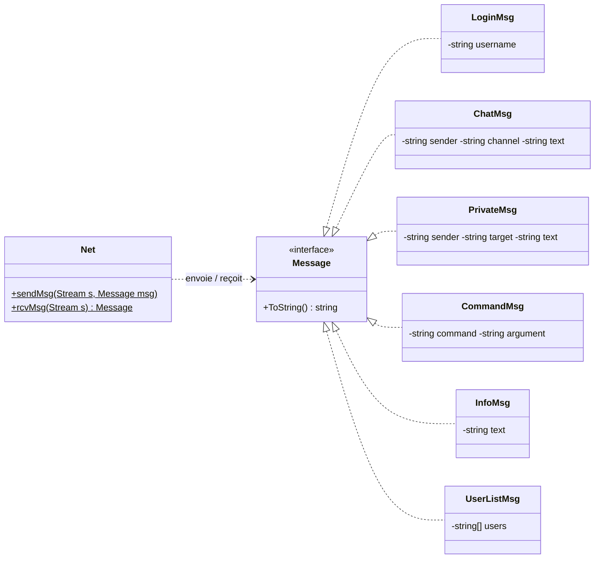
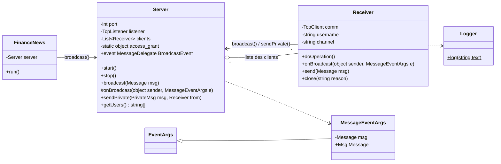
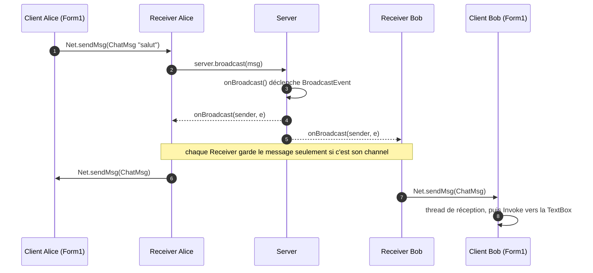
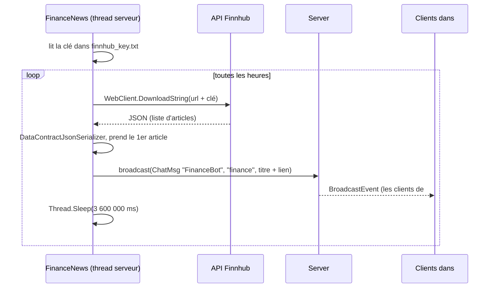

# Architecture de FinChat

## 1. Ce qu'on reprend du squelette DistantCalculator

| Dans DistantCalculator | Dans FinChat |
|---|---|
| Projet `Communication` (bibliothèque partagée) | Même projet, avec les messages du chat |
| `interface Message` + `Expr`, `Result` `[Serializable]` | `LoginMsg`, `ChatMsg`, `PrivateMsg`, `CommandMsg`, `InfoMsg`, `UserListMsg` |
| `Net.sendMsg / rcvMsg` (BinaryFormatter) | Gardé tel quel |
| `Server` + classe `Receiver`, 1 thread par client | Même principe + liste des clients + event de diffusion |
| `ClientGuiCalculator` (Form1, Windows Forms) | Fenêtre de chat |

## 2. Vue d'ensemble

## 3. Les messages (projet Communication)

| Classe | Sens | Utilisé pour |
|---|---|---|
| `LoginMsg` | client → serveur | Premier message après la connexion |
| `ChatMsg` | les 2 sens | Message public dans un channel (aussi les articles de FinanceBot) |
| `PrivateMsg` | les 2 sens | Message privé (`/msg bob salut`) |
| `CommandMsg` | client → serveur | `/name`, `/users`, `/join`, `/quit` |
| `InfoMsg` | serveur → client | Infos et erreurs |
| `UserListMsg` | serveur → client | Liste des connectés dans la fenêtre |

## 4. Les classes du serveur

## 5. Un message public, étape par étape

## 6. Le channel #finance

## 7. Les threads et ce qu'on protège

| Programme | Thread | Rôle |
|---|---|---|
| Serveur | principal | Lit `start` / `stop` / `exit` dans la console |
| Serveur | écoute | Boucle sur `AcceptTcpClient()`, crée un `Receiver` + son thread |
| Serveur | 1 par client | `Receiver.doOperation()` : lit les messages du client |
| Serveur | finance | `FinanceNews.run()` : 1 article par heure |
| Client | interface | Fenêtre, boutons, envoi |
| Client | réception | `Form1.receive()` : `Net.rcvMsg` puis `Invoke` |

| Donnée partagée | Problème | Protection |
|---|---|---|
| Liste des clients | Un client arrive pendant qu'on parcourt la liste | `lock(access_grant)`, objet `static` |
| Le flux d'un client | Deux threads écrivent en même temps dans le même socket | `lock(send_grant)` dans `Receiver.send()` |
| Fichier de log | Deux lignes écrites en même temps | `lock` dans `Logger.log()` |
| TextBox du client | `InvalidOperationException` (cross-thread) | `InvokeRequired` + `Invoke` |
