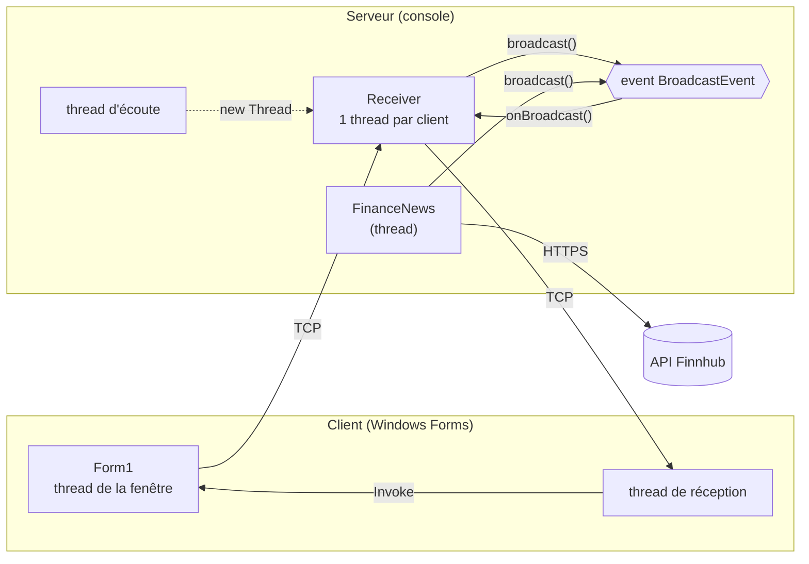
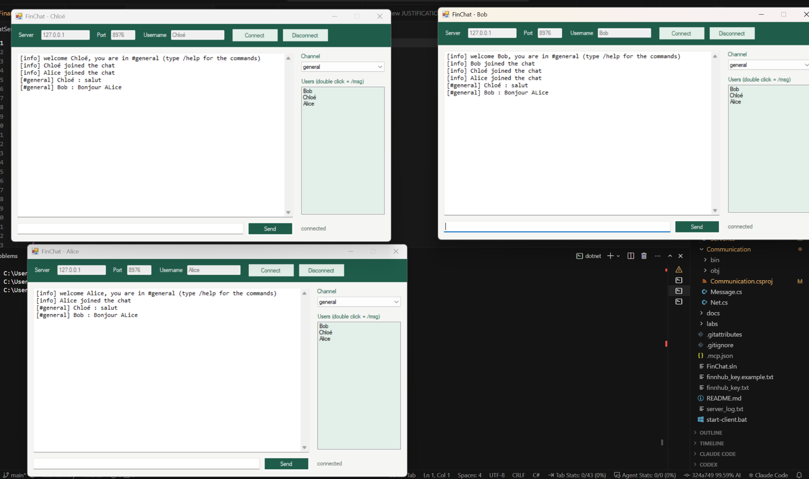
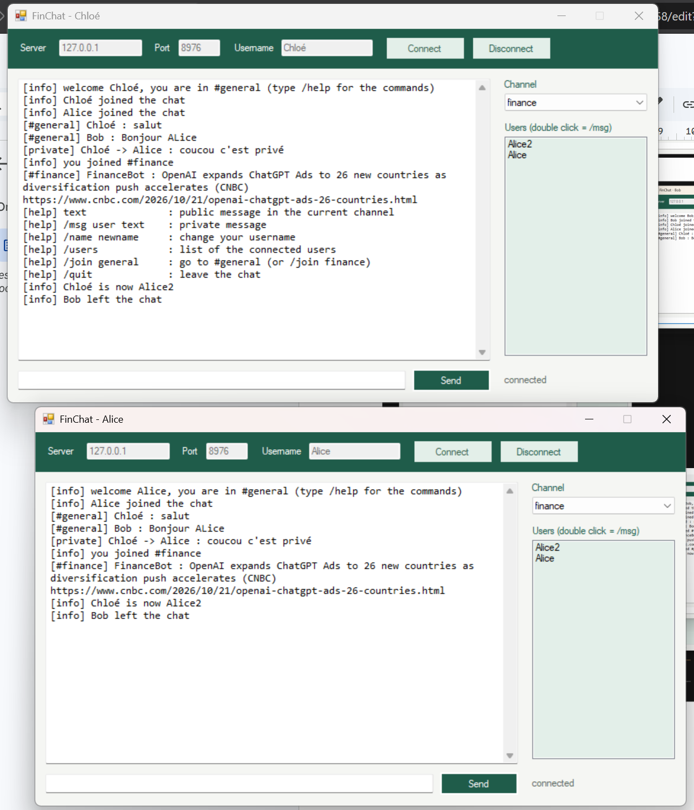
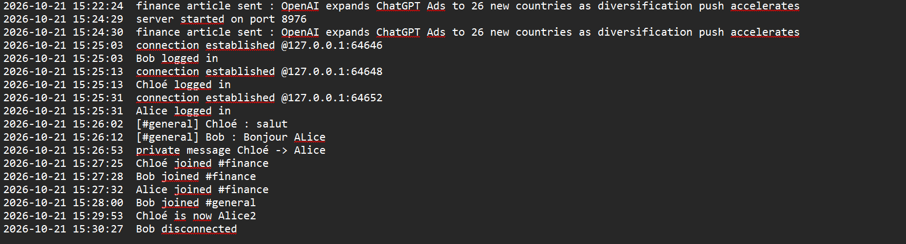
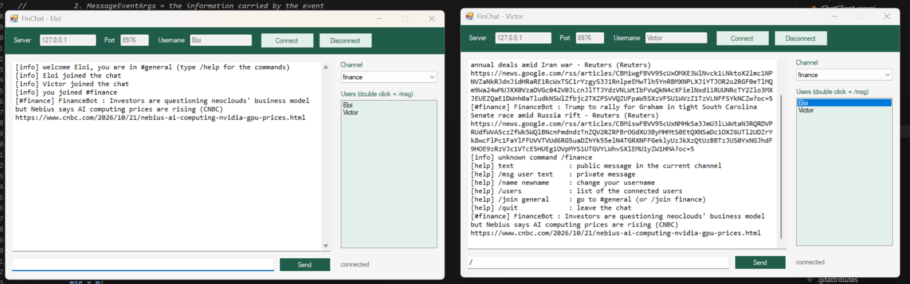

# FinChat : rapport de projet

**Cours :** Interface dev (C# / .NET), EFREI ING2  
**Binôme :** Victor Haegeman et Eloi Dumas  
**Code source :** https://github.com/VictorHaegeman/FinChat

---

## 1. Présentation

FinChat est une application de **chat en temps réel** en architecture **client-serveur**, sur **TCP**. Plusieurs utilisateurs se connectent au même serveur avec un pseudo et discutent dans deux channels : **#general** pour discuter, **#finance** pour l'actualité financière.

Le projet part du squelette **DistantCalculator** fourni en cours. On a gardé sa structure (une bibliothèque `Communication` partagée, un serveur avec un `Receiver` par client, un client Windows Forms) et on a remplacé le calcul à distance par le chat.

**Fonctionnalités :**

- connexion avec un pseudo unique ;
- messages publics dans le channel courant ;
- messages privés (`/msg pseudo texte`, ou double-clic sur un nom) ;
- deux channels, `#general` et `#finance` (`/join`, ou la liste déroulante) ;
- commandes : `/name` (changer de pseudo), `/users` (liste des connectés), `/help`, `/quit` ;
- liste des connectés mise à jour en direct ;
- journal de toute l'activité du serveur dans `server_log.txt` ;
- **ajout personnel : FinanceBot.** Un thread du serveur interroge l'API **Finnhub** à intervalle régulier et publie le dernier article financier dans `#finance`.

---

## 2. Lancer le projet

**Prérequis :** Windows et le SDK .NET. Les projets ciblent .NET Framework 4.8 : les fichiers nécessaires sont téléchargés automatiquement à la première compilation.

1. **Clé API (facultative) :** copier `finnhub_key.example.txt` en `finnhub_key.txt` et y mettre une clé gratuite Finnhub. Sans clé, le chat fonctionne et seul `#finance` reste vide.
2. **Serveur :** double-cliquer sur `start-server.bat`, puis taper `start` dans la console. Les autres commandes sont `stop` et `exit`.
3. **Clients :** double-cliquer sur `start-client.bat`, une fois par utilisateur. Dans la fenêtre : adresse `127.0.0.1`, port `8976`, un pseudo, puis **Connect**.

---

## 3. Architecture

### 3.1 Les trois projets

| Projet | Type | Rôle |
|---|---|---|
| `Communication` | bibliothèque (DLL) | Partagée par le client et le serveur : l'interface `Message`, les 6 classes de messages `[Serializable]`, et `Net` (envoi et réception avec `BinaryFormatter`) |
| `ChatServer` | application console | Accepte les clients, garde la liste des connectés, diffuse les messages avec un event, traite les commandes, écrit le journal, lance FinanceBot |
| `ChatClient` | Windows Forms | La fenêtre de chat : connexion, envoi, réception dans un thread séparé, affichage avec `Invoke` |

### 3.2 Vue d'ensemble



### 3.3 Les messages échangés

Chaque sorte de message est une classe de `Communication/Message.cs` qui implémente l'interface `Message`.

| Classe | Sens | Contenu | Rôle |
|---|---|---|---|
| `LoginMsg` | client → serveur | pseudo | Connexion |
| `ChatMsg` | dans les 2 sens | expéditeur, channel, texte | Message public |
| `PrivateMsg` | dans les 2 sens | expéditeur, destinataire, texte | Message privé |
| `CommandMsg` | client → serveur | commande, argument | `/name`, `/users`, `/join`, `/quit` |
| `InfoMsg` | serveur → client | texte | Information ou erreur |
| `UserListMsg` | serveur → client | tableau de pseudos | Liste des connectés |

### 3.4 Les threads

| Programme | Thread | Rôle | Code |
|---|---|---|---|
| Serveur | principal | Lit les commandes `start` / `stop` / `exit` | `Program.Main()` |
| Serveur | écoute | Attend les nouveaux clients (`AcceptTcpClient`) | `Server.listen()` |
| Serveur | 1 par client | Lit les messages de son client | `Receiver.doOperation()` |
| Serveur | finance | Publie un article à intervalle régulier | `FinanceNews.run()` |
| Client | fenêtre | Clics, saisie, affichage | `Program.Main()` → `Form1` |
| Client | réception | Attend les messages du serveur | `Form1.receive()` |

Avec deux clients connectés, le serveur a donc 5 threads et chaque client en a 2.

---

## 4. Implémentation

### 4.1 Envoyer un objet sur le réseau : la sérialisation

Le client et le serveur sont deux programmes séparés, et le réseau ne transporte que des octets. Chaque message est donc **sérialisé** (transformé en octets) avant l'envoi, puis **désérialisé** (reconstruit) à l'arrivée. Ce code vient du squelette :

```csharp
public static void sendMsg(Stream s, Message msg)
{
    BinaryFormatter bf = new BinaryFormatter();
    bf.Serialize(s, msg);
}

public static Message rcvMsg(Stream s)
{
    BinaryFormatter bf = new BinaryFormatter();
    return (Message)bf.Deserialize(s);
}
```

Toutes les classes de messages portent l'attribut `[Serializable]`. Elles sont dans la bibliothèque `Communication`, pour que le client et le serveur utilisent exactement les mêmes classes.

### 4.2 Côté client : créer et envoyer un message

Dans `Form1.buttonSend_Click()`, le texte tapé devient une commande s'il commence par `/`, sinon un message public :

```csharp
if (text.StartsWith("/"))
{
    sendCommand(text);                        // /msg → PrivateMsg, /name → CommandMsg...
}
else
{
    send(new ChatMsg(null, channel, text));   // message public
}
```

Le client n'indique **pas** son nom (`null`) : c'est le serveur qui ajoute le vrai pseudo. Un utilisateur ne peut donc pas se faire passer pour un autre.

### 4.3 Côté client : recevoir sans bloquer la fenêtre

`Net.rcvMsg()` est bloquant : il attend qu'un message arrive. Pour que la fenêtre reste utilisable, la réception tourne dans un **thread séparé**, lancé au clic sur Connect :

```csharp
receiveThread = new Thread(new ThreadStart(receive));
receiveThread.Start();
```

Mais seul le thread qui a créé la fenêtre a le droit de la modifier. Le thread de réception passe donc par `Invoke`, comme au Lab 2 :

```csharp
private void display(Message msg)
{
    if (InvokeRequired)
    {
        Invoke(new displayDelegate(display), new object[] { msg });
        return;
    }
    if (msg is UserListMsg)
    {
        // remplit la liste des connectés
    }
    else
    {
        addLine(msg.ToString());   // chaque message s'affiche avec son propre ToString()
    }
}
```

Chaque classe de message redéfinit `ToString()` avec `override`. La fenêtre n'a pas besoin de connaître le type du message pour l'afficher : c'est le late binding vu en cours.

### 4.4 Côté serveur : un thread par client

```csharp
TcpClient comm = listener.AcceptTcpClient();        // attend un client
Receiver r = new Receiver(comm, this);
addClient(r);
new Thread(new ThreadStart(r.doOperation)).Start();
```

Chaque `Receiver` lit les messages de son client en boucle et reconnaît leur type avec `is`, puis un cast :

```csharp
Message msg = Net.rcvMsg(comm.GetStream());
if (msg is LoginMsg)        login((LoginMsg)msg);
else if (msg is ChatMsg)    publicMessage((ChatMsg)msg);
else if (msg is PrivateMsg) server.sendPrivate(...);
else if (msg is CommandMsg) command((CommandMsg)msg);
```

### 4.5 La diffusion avec un delegate et un event

C'est la partie demandée par l'énoncé. Elle suit le modèle du cours et du Lab 2 :

```csharp
// le type de delegate (MessageEventArgs.cs)
public delegate void MessageDelegate(object sender, MessageEventArgs e);

// l'event et la méthode qui le déclenche (Server.cs)
public event MessageDelegate BroadcastEvent;

protected virtual void onBroadcast(object sender, MessageEventArgs e)
{
    MessageDelegate subscribers = BroadcastEvent;
    if (subscribers != null)
    {
        subscribers(sender, e);
    }
}

// abonnement au login, désabonnement à la déconnexion (Receiver.cs)
server.BroadcastEvent += new MessageDelegate(onBroadcast);
server.BroadcastEvent -= onBroadcast;
```

Le serveur déclenche l'event **une seule fois**, et la méthode `onBroadcast` de chaque client connecté est appelée. Chaque `Receiver` garde le message seulement s'il est dans le channel de son client, puis l'envoie.

Les **messages privés** n'utilisent pas l'event : le serveur cherche le destinataire dans la liste des clients et lui envoie le message directement, avec une copie pour l'expéditeur.

### 4.6 Les accès concurrents : `lock`

Plusieurs threads utilisent les mêmes données en même temps. On les protège avec `lock`, comme au Lab 4 :

- **la liste des clients** (`Server.cs`) : verrou `static`, partagé par tous les threads ;
- **l'envoi vers un client** (`Receiver.send()`) : un verrou par client, car deux threads peuvent écrire en même temps dans le même socket (par exemple un utilisateur et FinanceBot) ;
- **le fichier de log** (`Logger.log()`).

```csharp
private static object access_grant = new object();

public void addClient(Receiver r)
{
    lock (access_grant)
    {
        clients.Add(r);
    }
}
```

### 4.7 FinanceBot

`FinanceNews` tourne dans son propre thread. À chaque intervalle, il appelle l'API Finnhub, lit la réponse JSON et publie l'article avec le **même** `broadcast()` que les utilisateurs. Un utilisateur qui rejoint `#finance` reçoit aussi le dernier article publié. La clé API est lue dans `finnhub_key.txt`, qui n'est pas publié sur GitHub.

### 4.8 Le journal

`Logger.log()` écrit chaque événement, avec la date et l'heure, dans la console et dans `server_log.txt` (un `StreamWriter` en mode ajout, protégé par un `lock`).

### 4.9 Les erreurs

Les déconnexions sont attrapées avec `try` / `catch`. Un client qui ferme sa fenêtre est retiré proprement : le serveur continue de fonctionner et les autres sont prévenus. Le client affiche aussi un message clair si le serveur est absent ou s'arrête.

---

## 5. Lien avec le cours

| Notion | Chapitre | Où dans FinChat |
|---|---|---|
| Attributs `private`, propriétés, `static` | 1, C# basics | Classes de messages, `Logger`, verrous |
| Interface, polymorphisme, `is` + cast, `override` | 2, Classification | `interface Message`, `Receiver.doOperation()`, `Form1.display()` |
| Exceptions `try` / `catch` | 2, Classification | Déconnexions, API indisponible |
| Delegates et events, `+=` / `-=` | 3, Delegates & Events | `BroadcastEvent`, `MessageDelegate` |
| Threads, `lock` | 4, Threads | Écoute, 1 thread par client, FinanceBot, réception côté client |
| `TcpListener`, `TcpClient` | 4, Networking | `Server.start()`, bouton Connect |
| `StreamWriter`, `StreamReader` | 5, IO | Journal, lecture de la clé API |
| `[Serializable]`, `BinaryFormatter` | 6, Serialization | Messages, `Net.cs` |
| `List<T>` | 7 et 8, Generics et Collections | Liste des clients |
| `Invoke` | Lab 2 | Affichage dans le client |

---

## 6. Démonstration

### 6.1 Échange public entre trois clients



*Alice, Bob et Chloé sont connectés dans #general. Chloé écrit « salut » et Bob répond : le message est diffusé à tous grâce à l'event. La liste des connectés est à jour dans chaque fenêtre.*

### 6.2 Message privé


*Chloé envoie un message privé à Alice. Il apparaît chez Chloé et chez Alice (`[private] Chloé -> Alice`), mais **pas chez Bob**.*

### 6.3 Channel #finance et FinanceBot


*Chloé et Alice rejoignent #finance et reçoivent l'article publié par FinanceBot (titre, source et lien). Bob a rejoint #finance, puis il revient dans #general avec la liste déroulante.*

### 6.4 Commandes


*Chloé tape `/help`, affiché directement par le client, puis `/name Alice2` : tous les utilisateurs voient « Chloé is now Alice2 » et la liste des connectés est mise à jour.*

### 6.5 Déconnexion



*Bob se déconnecte : les autres voient « Bob left the chat » et Bob disparaît de la liste.*

### 6.6 Journal du serveur



*`server_log.txt` : chaque action est datée (connexions, messages publics, message privé, changements de channel, changement de pseudo, déconnexion). Le contenu des messages privés n'est pas enregistré, seulement l'expéditeur et le destinataire.*

### 6.7 Plusieurs articles au fil du temps



*Une autre session, avec l'intervalle réduit pour la démonstration : plusieurs articles de FinanceBot arrivent dans #finance. Une commande inconnue (`/finance`) est signalée par le serveur (« unknown command »).*

---

## 7. Tests

| Test | Résultat attendu | Résultat |
|---|---|---|
| Connexion de plusieurs clients | Chacun voit les autres dans la liste | OK (capture 1) |
| Message public | Reçu par tous les clients du channel | OK (capture 1) |
| Message privé | Reçu seulement par l'expéditeur et le destinataire | OK (capture 2) |
| Changement de channel | Message « you joined #finance » et dernier article | OK (capture 3) |
| Article finance automatique | Articles de FinanceBot dans #finance | OK (captures 3 et 7) |
| `/help` | Liste des commandes | OK (capture 4) |
| `/name` | Tout le monde est prévenu, liste mise à jour | OK (capture 4) |
| Commande inconnue | Message « unknown command » | OK (capture 7) |
| Pseudo avec accent (Chloé) | Affiché correctement partout | OK (captures 1 à 6) |
| Déconnexion | Les autres voient « left the chat » | OK (capture 5) |
| Journal | Toutes les actions datées | OK (capture 6) |

Le plan de test complet est dans `docs/TESTS.md`.

---

## 8. Choix techniques et limites

- **.NET Framework 4.8 :** le `BinaryFormatter` du squelette et du cours n'existe plus dans .NET 9/10.
- **Adresse 127.0.0.1 :** comme dans le cours, le serveur accepte les clients du même ordinateur. Pour un vrai réseau, il suffit de remplacer par `IPAddress.Any`.
- **`BinaryFormatter`** n'est pas sûr face à des données malveillantes. C'est acceptable ici (usage local, cadre du cours), mais il faudrait le remplacer dans une vraie application.
- **Partie hors cours :** la requête HTTP et la lecture du JSON de FinanceBot (`WebClient`, `DataContractJsonSerializer`). Elle est isolée dans une seule méthode, `FinanceNews.getLastArticle()`.
- **Intervalle de FinanceBot :** prévu pour une heure. Il est réglable avec la constante `INTERVAL` et peut être réduit à une minute pour une démonstration.
- **Limites connues :** les channels sont fixes (`general` et `finance`), il n'y a ni mot de passe ni historique des messages, et après un `/name`, le titre de la fenêtre garde l'ancien pseudo.

---

## 9. Répartition du travail

| Partie | Responsable |
|---|---|
| Client Windows Forms (fenêtre, envoi, réception, `Invoke`) et messages (`Communication`) | Victor Haegeman |
| Serveur (connexions, diffusion par event, commandes, `lock`, journal, FinanceBot) | Eloi Dumas |
| Architecture, tests, documentation et labs | Ensemble |
