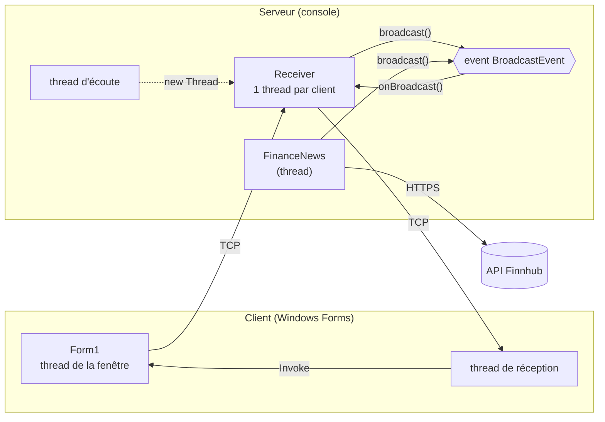
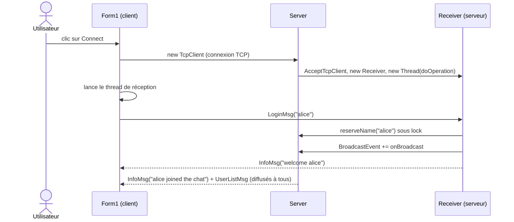
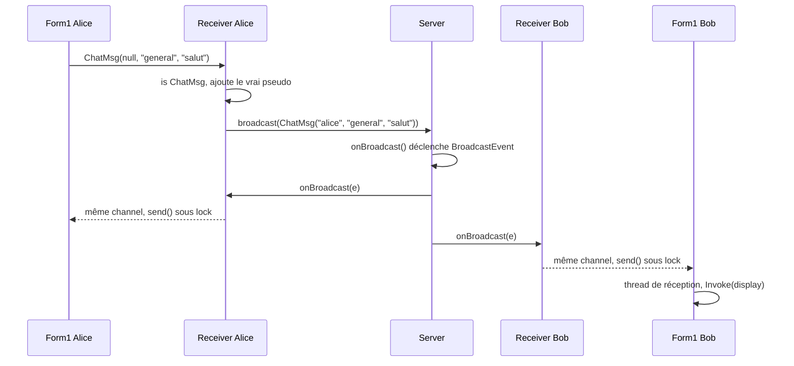
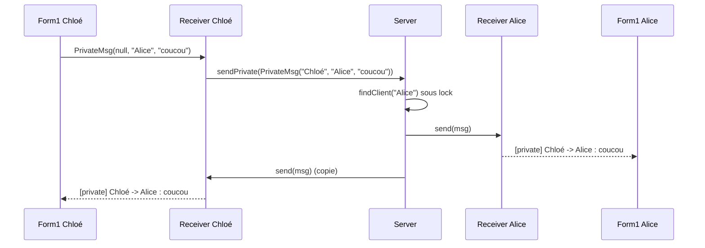
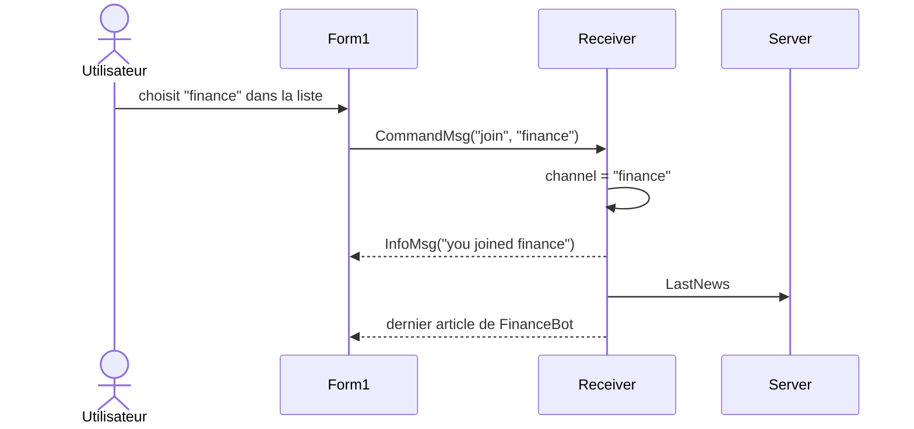
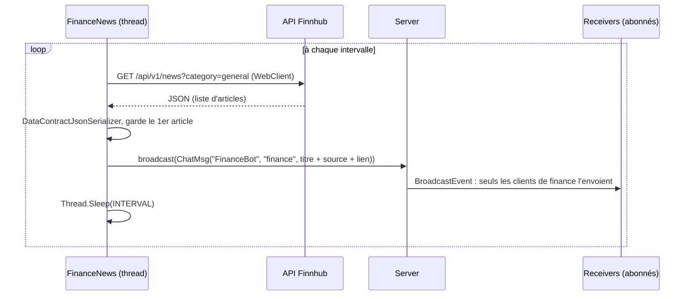
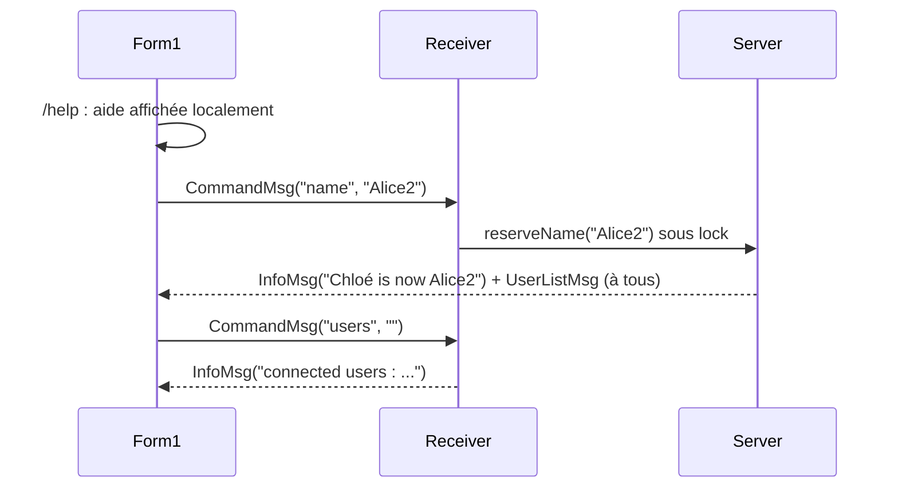
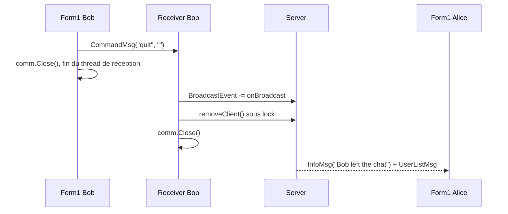

# FinChat : rapport de projet

**Cours :** Interface dev (C# / .NET), EFREI ING2  
**Binôme :** Victor Haegeman et Eloi Dumas  
**Code source :** https://github.com/VictorHaegeman/FinChat

FinChat est une application de **chat en temps réel** en architecture **client-serveur** sur **TCP**, construite à partir du squelette **DistantCalculator** du cours. Plusieurs utilisateurs se connectent au même serveur et discutent dans deux channels : **#general** et **#finance**. Dans #finance, un robot, **FinanceBot**, publie automatiquement des articles financiers récupérés sur l'**API Finnhub**.

Le rapport suit l'ordre demandé : **a.** les fonctionnalités implémentées, **b.** la conception de chaque fonctionnalité (diagrammes de séquence et captures), **c.** les principales parties de l'implémentation en C#.

---

## a. Fonctionnalités implémentées

| # | Fonctionnalité | Description | État |
|---|---|---|---|
| 1 | Serveur multi-clients | Le serveur accepte plusieurs clients en même temps (un thread par client). Commandes console : `start`, `stop`, `exit` | Fait |
| 2 | Connexion avec pseudo | Le client se connecte avec un pseudo. Le serveur refuse un pseudo vide, avec espace ou déjà pris | Fait |
| 3 | **Diffusion des messages (delegate)** | Un message public est diffusé à tous les clients du même channel grâce à un **event** (delegate) | Fait |
| 4 | Messages privés | `/msg pseudo texte`, ou double-clic sur un nom : le message n'arrive qu'au destinataire | Fait |
| 5 | Channels | Deux channels, `#general` et `#finance`. Changement avec la liste déroulante ou `/join` | Fait |
| 6 | **Connexion à une API (FinanceBot)** | Un thread du serveur interroge l'API Finnhub à intervalle régulier et publie le dernier article dans `#finance` | Fait |
| 7 | Commandes | `/name` (changer de pseudo), `/users` (liste des connectés), `/help`, `/quit` | Fait |
| 8 | Liste des connectés | Mise à jour en direct dans chaque fenêtre | Fait |
| 9 | Déconnexion propre | Bouton Disconnect, `/quit` ou fermeture de la fenêtre : les autres sont prévenus et le serveur continue | Fait |
| 10 | Journal du serveur | Toute l'activité est écrite, avec la date, dans la console et dans `server_log.txt` | Fait |

---

## b. Conception de chaque fonctionnalité

### b.0 Architecture générale

Le projet reprend la structure du squelette, en trois projets :

| Projet | Type | Rôle |
|---|---|---|
| `Communication` | bibliothèque (DLL) | Partagée par le client et le serveur : l'interface `Message`, les 6 classes de messages `[Serializable]`, et `Net` (envoi et réception avec `BinaryFormatter`) |
| `ChatServer` | application console | `Server` (écoute, liste des clients, event de diffusion), `Receiver` (un par client, dans son thread), `FinanceNews` (FinanceBot), `Logger` |
| `ChatClient` | Windows Forms | `Form1` : la fenêtre, l'envoi, et un thread de réception qui affiche avec `Invoke` |



**Les messages échangés.** Chaque sorte de message est une classe qui implémente l'interface `Message`. Le receveur reconnaît le type avec `is` puis un cast.

| Classe | Sens | Contenu | Rôle |
|---|---|---|---|
| `LoginMsg` | client → serveur | pseudo | Connexion |
| `ChatMsg` | dans les 2 sens | expéditeur, channel, texte | Message public |
| `PrivateMsg` | dans les 2 sens | expéditeur, destinataire, texte | Message privé |
| `CommandMsg` | client → serveur | commande, argument | `/name`, `/users`, `/join`, `/quit` |
| `InfoMsg` | serveur → client | texte | Information ou erreur |
| `UserListMsg` | serveur → client | tableau de pseudos | Liste des connectés |

**Les threads.** Côté serveur : le thread principal (commandes console), le thread d'écoute, un thread par client et le thread de FinanceBot. Côté client : le thread de la fenêtre et le thread de réception. Les données partagées entre threads (liste des clients, envoi vers un même client, fichier de log) sont protégées par `lock`.

---

### b.1 Connexion et login

Le client ouvre une connexion TCP. Côté serveur, le thread d'écoute crée un `Receiver` et lui donne son propre thread. Le client lance son thread de réception, puis envoie un `LoginMsg`. Le serveur vérifie le pseudo **et** le réserve dans le même `lock`, abonne le `Receiver` à l'event de diffusion, puis prévient tout le monde.



Si le pseudo est vide, contient un espace ou est déjà pris, le serveur envoie la raison et ferme la connexion.

---

### b.2 Diffusion des messages publics (delegate)

C'est la fonctionnalité demandée avec un delegate. Le serveur a un **event** `BroadcastEvent` de type `MessageDelegate`. Chaque `Receiver` s'y abonne au login (`+=`) et s'en désabonne en partant (`-=`). Pour diffuser, le serveur déclenche l'event **une seule fois** : la méthode `onBroadcast` de chaque client connecté est appelée (delegate multicast). Chaque `Receiver` garde le message seulement s'il est dans le channel de son client.

Le client n'envoie que le texte et le channel. C'est le serveur qui ajoute le vrai pseudo de l'expéditeur, pour qu'on ne puisse pas se faire passer pour un autre.




*Alice, Bob et Chloé sont connectés dans #general. Chloé écrit « salut » et Bob répond : chaque message est reçu par les trois clients, et la liste des connectés est à jour.*

---

### b.3 Messages privés

Un message privé est une autre classe, `PrivateMsg`, qui contient un **destinataire** au lieu d'un channel. Il ne passe **pas** par l'event : le serveur cherche le destinataire dans la liste des clients et lui envoie le message directement, avec une copie pour l'expéditeur. Si le destinataire n'existe pas, l'expéditeur est prévenu.




*Chloé envoie un message privé à Alice. Il apparaît chez Chloé et chez Alice, mais pas chez Bob.*

---

### b.4 Channels

Chaque `Receiver` retient le channel de son client (`general` au départ). Changer de channel dans la liste déroulante, ou taper `/join finance`, envoie un `CommandMsg("join", ...)`. Le `Receiver` met à jour son channel. Quand on arrive dans #finance, on reçoit aussi le dernier article publié par FinanceBot.



À partir de là, `Receiver.onBroadcast()` ne transmet plus que les messages du channel `finance` à ce client.


*Chloé et Alice rejoignent #finance et reçoivent l'article de FinanceBot. Bob a rejoint #finance, puis il est revenu dans #general.*

---

### b.5 Connexion à l'API : FinanceBot

`FinanceNews` tourne dans son propre thread. Au démarrage, il lit la clé API dans `finnhub_key.txt`. Ensuite, en boucle : il appelle l'API Finnhub en HTTPS, lit la réponse JSON, garde le premier article et le publie avec le **même** `broadcast()` que les utilisateurs, au nom de `FinanceBot` et dans le channel `finance`. Puis il dort pendant l'intervalle (`Thread.Sleep`). Un article déjà envoyé n'est pas renvoyé.



Sans clé API, ou si l'API ne répond pas, l'erreur est écrite dans le journal et le chat continue de fonctionner.


*Avec l'intervalle réduit pour la démonstration, plusieurs articles de FinanceBot arrivent au fil du temps dans #finance.*

---

### b.6 Commandes

Tout texte qui commence par `/` est une commande. Le client la découpe : `/msg` devient un `PrivateMsg`, `/help` est affiché directement par le client, `/quit` déconnecte, et les autres (`/name`, `/users`) partent au serveur dans un `CommandMsg`. Le serveur traite chaque commande dans un `switch`. Pour `/name`, il vérifie que le nouveau pseudo est libre (sous `lock`), puis prévient tout le monde et renvoie la liste des connectés.




*Chloé tape `/help`, puis `/name Alice2` : tous les utilisateurs voient le changement, et la liste des connectés est mise à jour. Une commande inconnue renvoie « unknown command » (capture b.5).*

---

### b.7 Déconnexion

Quand un client part (bouton Disconnect, `/quit` ou fermeture de la fenêtre), il envoie `/quit` et ferme sa connexion. Côté serveur, `Receiver.close()` désabonne le client de l'event (`-=`), le retire de la liste, ferme le socket, puis prévient les autres. Si la connexion est coupée brutalement, `rcvMsg` lance une exception, attrapée par un `try` / `catch`, et on passe par le même `close()` : le serveur ne plante pas.




*Bob se déconnecte : les autres voient « Bob left the chat » et Bob disparaît de la liste.*

---

### b.8 Journal du serveur

Chaque événement passe par `Logger.log()`, une méthode `static` appelée depuis tous les threads. Elle écrit la ligne, avec la date et l'heure, dans la console et à la fin de `server_log.txt`, sous `lock` pour que deux threads n'écrivent pas en même temps. Le contenu des messages privés n'est pas enregistré, seulement l'expéditeur et le destinataire.


*Extrait de `server_log.txt` : connexions, messages publics, message privé, changements de channel, changement de pseudo, déconnexion.*

---

## c. Principales parties de l’implémentation en C\#

### c.1 Les messages (`Communication/Message.cs`)

Une interface commune, et une classe `[Serializable]` par sorte de message, avec des attributs `private`, des propriétés en lecture seule et `ToString()` redéfini :

```csharp
public interface Message
{
    string ToString();
}

[Serializable]
public class ChatMsg : Message
{
    private string sender;
    private string channel;
    private string text;

    public ChatMsg(string sender, string channel, string text)
    {
        this.sender = sender;
        this.channel = channel;
        this.text = text;
    }

    public string Channel
    {
        get { return channel; }
    }
    // Sender et Text : même principe

    public override string ToString()
    {
        return "[#" + channel + "] " + sender + " : " + text;
    }
}
```

### c.2 L'envoi sur le réseau (`Communication/Net.cs`)

Repris du squelette : un message est sérialisé directement dans le flux TCP.

```csharp
public static void sendMsg(Stream s, Message msg)
{
    BinaryFormatter bf = new BinaryFormatter();
    bf.Serialize(s, msg);
}

public static Message rcvMsg(Stream s)          // bloquant
{
    BinaryFormatter bf = new BinaryFormatter();
    return (Message)bf.Deserialize(s);
}
```

### c.3 Le client : envoi, réception et affichage (`ChatClient/Form1.cs`)

```csharp
// clic sur Send : une commande ou un message public
if (text.StartsWith("/"))
{
    sendCommand(text);                         // /msg → PrivateMsg, /name → CommandMsg...
}
else
{
    send(new ChatMsg(null, channel, text));    // le serveur ajoutera le vrai pseudo
}

// thread de réception, lancé au clic sur Connect
receiveThread = new Thread(new ThreadStart(receive));
receiveThread.Start();

private void receive()
{
    try
    {
        while (true)
        {
            Message msg = Net.rcvMsg(comm.GetStream());
            display(msg);
        }
    }
    catch (Exception)
    {
        // la connexion est fermée
    }
    disconnected();
}

// seul le thread de la fenêtre peut la modifier : Invoke
private void display(Message msg)
{
    if (InvokeRequired)
    {
        Invoke(new displayDelegate(display), new object[] { msg });
        return;
    }
    if (msg is UserListMsg)
    {
        listBoxUsers.Items.Clear();
        foreach (string user in ((UserListMsg)msg).Users)
        {
            listBoxUsers.Items.Add(user);
        }
    }
    else
    {
        addLine(msg.ToString());
    }
}
```

### c.4 Le serveur : un thread par client (`Server.cs`, `Receiver.cs`)

```csharp
// Server.listen() : thread d'écoute
TcpClient comm = listener.AcceptTcpClient();        // bloquant
Receiver r = new Receiver(comm, this);
addClient(r);
new Thread(new ThreadStart(r.doOperation)).Start();

// Receiver.doOperation() : lit les messages de son client
Message msg = Net.rcvMsg(comm.GetStream());
if (msg is LoginMsg)
    login((LoginMsg)msg);
else if (msg is ChatMsg)
    publicMessage((ChatMsg)msg);
else if (msg is PrivateMsg)
{
    PrivateMsg pm = (PrivateMsg)msg;
    server.sendPrivate(new PrivateMsg(username, pm.Target, pm.Text), this);
}
else if (msg is CommandMsg)
    command((CommandMsg)msg);
```

### c.5 La diffusion avec un delegate et un event

```csharp
// MessageEventArgs.cs : le delegate et l'information transportée
public delegate void MessageDelegate(object sender, MessageEventArgs e);

// Server.cs : l'event et la méthode qui le déclenche
public event MessageDelegate BroadcastEvent;

protected virtual void onBroadcast(object sender, MessageEventArgs e)
{
    MessageDelegate subscribers = BroadcastEvent;
    if (subscribers != null)
    {
        subscribers(sender, e);          // appelle onBroadcast de chaque abonné
    }
}

public void broadcast(Message msg)
{
    onBroadcast(this, new MessageEventArgs(msg));
}

// Receiver.cs : abonnement au login, réaction, désabonnement
server.BroadcastEvent += new MessageDelegate(onBroadcast);

public void onBroadcast(object sender, MessageEventArgs e)
{
    if (e.Msg is ChatMsg && ((ChatMsg)e.Msg).Channel != channel)
    {
        return;                          // pas le channel de mon client
    }
    send(e.Msg);
}

server.BroadcastEvent -= onBroadcast;    // dans close()
```

### c.6 Les messages privés (`Server.sendPrivate()`)

```csharp
public void sendPrivate(PrivateMsg msg, Receiver from)
{
    Receiver target = findClient(msg.Target);
    if (target == null)
    {
        from.send(new InfoMsg("user " + msg.Target + " not found"));
        return;
    }
    target.send(msg);
    if (target != from)
    {
        from.send(msg);                  // copie pour l'expéditeur
    }
}
```

### c.7 Les accès concurrents (`lock`)

```csharp
// la liste des clients : un verrou static partagé par tous les threads
private static object access_grant = new object();

public void addClient(Receiver r)
{
    lock (access_grant)
    {
        clients.Add(r);
    }
}

// l'envoi vers un client : un verrou par client (Receiver.send)
lock (send_grant)
{
    Net.sendMsg(comm.GetStream(), msg);
}
```

### c.8 FinanceBot (`FinanceNews.cs`)

```csharp
// version simplifiée : sans les try / catch (pas de clé, API indisponible)
public void run()                         // le thread de FinanceBot
{
    apiKey = readKey();                   // StreamReader sur finnhub_key.txt
    while (true)
    {
        if (server.Running)
        {
            sendLastArticle();            // appelle l'API puis server.broadcast(...)
        }
        Thread.Sleep(INTERVAL);
    }
}

private Article getLastArticle()
{
    WebClient web = new WebClient();
    string json = web.DownloadString(URL + apiKey);
    DataContractJsonSerializer ser = new DataContractJsonSerializer(typeof(Article[]));
    MemoryStream ms = new MemoryStream(Encoding.UTF8.GetBytes(json));
    Article[] articles = (Article[])ser.ReadObject(ms);
    return articles[0];                   // le plus récent
}
```

### c.9 Le journal (`Logger.cs`)

```csharp
// version simplifiée : sans le try / catch autour de l'écriture du fichier
public static void log(string text)
{
    string line = DateTime.Now.ToString("yyyy-MM-dd HH:mm:ss") + "  " + text;
    lock (access_grant)
    {
        Console.WriteLine(line);
        using (StreamWriter sw = new StreamWriter("server_log.txt", true))   // true = ajout
        {
            sw.WriteLine(line);
        }
    }
}
```

---

## Annexe

### Lancer le projet

1. Copier `finnhub_key.example.txt` en `finnhub_key.txt` et y mettre une clé Finnhub gratuite. Sans clé, le chat fonctionne et seul `#finance` reste vide.
2. Double-cliquer sur `start-server.bat`, puis taper `start`.
3. Double-cliquer sur `start-client.bat` (une fois par utilisateur), puis entrer `127.0.0.1`, `8976` et un pseudo, et cliquer sur **Connect**.

### Choix techniques et limites

- **.NET Framework 4.8**, parce que le `BinaryFormatter` du squelette et du cours n'existe plus dans .NET 9/10.
- **Adresse 127.0.0.1**, comme dans le cours. Pour un vrai réseau, il suffit de la remplacer par `IPAddress.Any`.
- **`BinaryFormatter`** n'est pas sûr face à des données malveillantes. C'est acceptable dans le cadre du cours, mais il faudrait le remplacer dans une vraie application.
- **Partie hors cours :** la requête HTTP et la lecture du JSON, isolées dans `FinanceNews.getLastArticle()`.
- **Intervalle de FinanceBot :** constante `INTERVAL`, mise à une minute pour la démonstration (une heure en usage normal).
- **Limites :** les channels sont fixes, il n'y a ni mot de passe ni historique, et après `/name`, le titre de la fenêtre garde l'ancien pseudo.

### Répartition du travail

- **Victor Haegeman :** le client Windows Forms et les messages (`Communication`).
- **Eloi Dumas :** le serveur (connexions, diffusion, commandes, FinanceBot, journal).
- **Ensemble :** l'architecture, les tests, la documentation et les labs.
