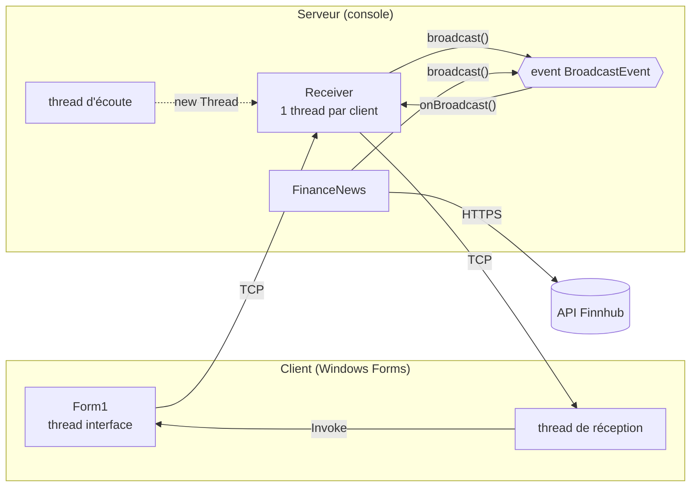
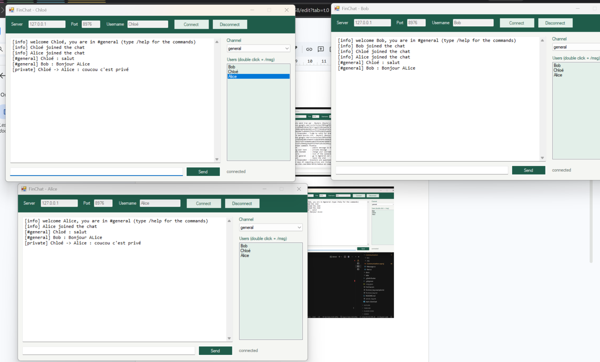
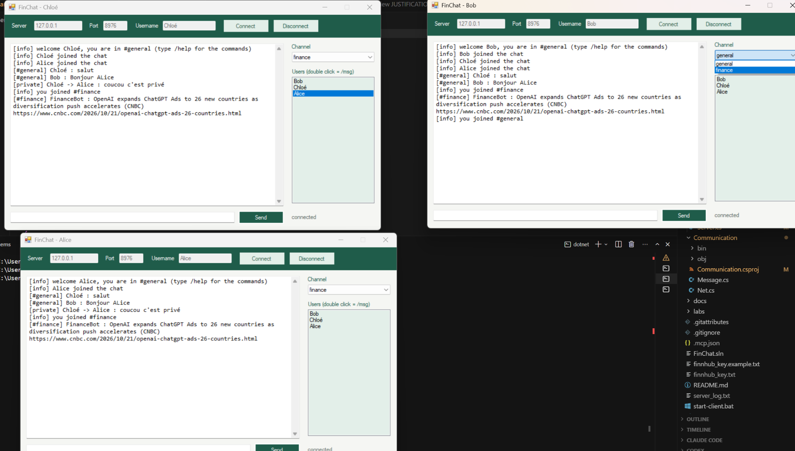
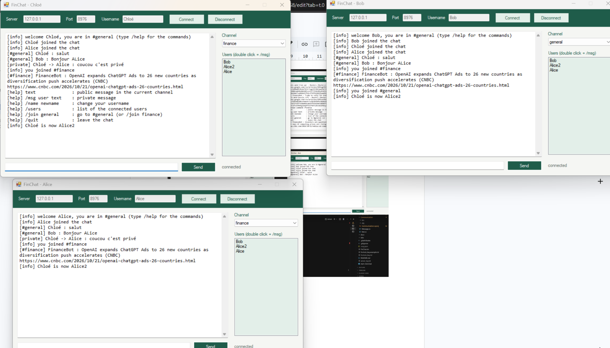

# FinChat — Documentation du projet

**Cours** : Interface dev (C# / .NET) — EFREI ING2
**Binôme** : Victor Haegeman, *(binôme)*
**Code source** : dépôt GitHub `FinChat`

---

## 1. Présentation

FinChat est une application de chat en temps réel, en architecture **client–serveur** sur **TCP**. Plusieurs clients se connectent au même serveur, choisissent un pseudo et discutent dans deux channels : `#general` et `#finance`.

Le projet part du squelette **DistantCalculator** fourni en cours. Nous avons gardé sa structure (bibliothèque `Communication`, serveur avec un `Receiver` par client, client Windows Forms) et remplacé le calcul à distance par le chat.

**Ajout personnel** : un thread du serveur interroge l'API **Finnhub** toutes les heures et publie le dernier article financier dans `#finance`, au nom de `FinanceBot`.

---

## 2. Architecture

### 2.1 Les trois projets

| Projet | Type | Rôle |
|---|---|---|
| `Communication` | bibliothèque | Classes partagées : l'interface `Message`, les 6 messages `[Serializable]`, et `Net` (envoi / réception avec `BinaryFormatter`) |
| `ChatServer` | console | Accepte les clients, garde la liste des connectés, diffuse les messages avec un event, gère les commandes, les logs et le thread finance |
| `ChatClient` | Windows Forms | Fenêtre de chat : connexion, envoi, réception dans un thread séparé, affichage avec `Invoke` |

### 2.2 Vue d'ensemble



### 2.3 Les messages échangés

| Classe | Sens | Rôle |
|---|---|---|
| `LoginMsg` | client → serveur | Connexion avec un pseudo |
| `ChatMsg` | les 2 sens | Message public dans un channel |
| `PrivateMsg` | les 2 sens | Message privé |
| `CommandMsg` | client → serveur | `/name`, `/users`, `/join`, `/quit` |
| `InfoMsg` | serveur → client | Information ou erreur |
| `UserListMsg` | serveur → client | Liste des connectés |

### 2.4 Les threads

| Programme | Thread | Rôle |
|---|---|---|
| Serveur | principal | Commandes `start` / `stop` / `exit` |
| Serveur | écoute | `AcceptTcpClient()` en boucle |
| Serveur | 1 par client | Lecture des messages du client (`Receiver.doOperation()`) |
| Serveur | finance | 1 article par heure (`FinanceNews.run()`) |
| Client | interface | Fenêtre et envoi |
| Client | réception | Lecture des messages du serveur, puis `Invoke` |

Schémas détaillés (classes, séquences) : `docs/ARCHITECTURE.md`.

---

## 3. Parties importantes de l'implémentation

### 3.1 Envoi d'un objet sur le réseau (sérialisation)

Repris du squelette. Un objet `Message` est sérialisé directement dans le flux TCP.

```csharp
public static void sendMsg(Stream s, Message msg)
{
    BinaryFormatter bf = new BinaryFormatter();
    bf.Serialize(s, msg);
}
```

Toutes les classes de messages sont `[Serializable]` et se trouvent dans la bibliothèque `Communication`, partagée par le client et le serveur.

### 3.2 Un thread par client

```csharp
TcpClient comm = listener.AcceptTcpClient();      // bloquant
Receiver r = new Receiver(comm, this);
addClient(r);
new Thread(new ThreadStart(r.doOperation)).Start();
```

Chaque `Receiver` lit les messages de son client en boucle et reconnaît leur type avec `is` puis un cast :

```csharp
Message msg = Net.rcvMsg(comm.GetStream());
if (msg is LoginMsg)        login((LoginMsg)msg);
else if (msg is ChatMsg)    publicMessage((ChatMsg)msg);
else if (msg is PrivateMsg) ...
else if (msg is CommandMsg) command((CommandMsg)msg);
```

### 3.3 Diffusion avec un delegate et un event

C'est la partie imposée par l'énoncé. Elle suit le modèle du cours (et du Lab 2) :

```csharp
// le delegate et l'information transportée
public delegate void MessageDelegate(object sender, MessageEventArgs e);

// dans Server : l'event et la méthode qui le déclenche
public event MessageDelegate BroadcastEvent;

protected virtual void onBroadcast(object sender, MessageEventArgs e)
{
    MessageDelegate subscribers = BroadcastEvent;
    if (subscribers != null)
    {
        subscribers(sender, e);
    }
}

// dans Receiver : abonnement au login, désabonnement à la déconnexion
server.BroadcastEvent += new MessageDelegate(onBroadcast);
server.BroadcastEvent -= onBroadcast;
```

Le serveur ne parcourt pas la liste des clients pour diffuser : il déclenche l'event, et chaque `Receiver` abonné reçoit le message. Chacun garde seulement les messages de son channel.

### 3.4 Accès concurrents (`lock`)

La liste des clients est utilisée par plusieurs threads en même temps. Elle est protégée par un verrou `static`, comme au Lab 4 :

```csharp
private static object access_grant = new object();

public void addClient(Receiver r)
{
    lock (access_grant)
    {
        clients.Add(r);
    }
}
```

Chaque `Receiver` a aussi son propre verrou pour l'envoi, car deux threads peuvent écrire en même temps dans le même socket (par exemple un message d'un utilisateur et un article finance).

### 3.5 Affichage thread-safe dans le client (`Invoke`)

Les messages arrivent dans le thread de réception, mais la `TextBox` appartient au thread de la fenêtre. Comme au Lab 2 :

```csharp
private void display(Message msg)
{
    if (InvokeRequired)
    {
        Invoke(new displayDelegate(display), new object[] { msg });
        return;
    }
    addLine(msg.ToString());
}
```

### 3.6 Le channel #finance

`FinanceNews` tourne dans son propre thread. Toutes les heures, il appelle l'API Finnhub, lit le JSON avec `DataContractJsonSerializer` et envoie l'article avec le **même** `broadcast()` que les utilisateurs. La clé API est lue dans un fichier `finnhub_key.txt` (exclu de GitHub). C'est la seule partie du code qui n'est pas dans le cours.

### 3.7 Logs

`Logger.log()` écrit chaque événement dans la console et dans `server_log.txt` avec un `StreamWriter` en mode ajout, protégé par un `lock`.

---

## 4. Choix et limites

- **.NET Framework 4.8** : le `BinaryFormatter` du squelette n'existe plus dans .NET 9/10.
- **127.0.0.1** : comme dans le cours, le serveur accepte les clients du même PC. `IPAddress.Any` permettrait d'autres PC.
- **`BinaryFormatter`** n'est pas sûr face à des données malveillantes : acceptable ici (réseau local, cadre du cours), à remplacer dans une vraie application.
- **Channels fixes** : `general` et `finance`.

---

## 5. Captures d'écran et tests

### 5.1 Captures


*Deux clients dans #general.*


*Message privé avec `/msg`.*


*Article publié par FinanceBot dans #finance.*


*`/help`, `/users`, `/name`.*


*Logs du serveur pendant les tests.*

### 5.2 Tests réalisés

| Test | Résultat attendu | Résultat |
|---|---|---|
| Connexion de 2 clients | Chacun voit l'autre dans la liste | OK |
| Message public | Reçu par tous les clients du channel | OK |
| Pseudo déjà pris | Connexion refusée | *à compléter* |
| Message privé | Reçu seulement par le destinataire | *à compléter* |
| Changement de channel | Les messages de #general ne s'affichent plus dans #finance | OK |
| Article finance | Un article de FinanceBot arrive dans #finance | OK |
| `/name`, `/users`, `/help` | Réponses correctes | *à compléter* |
| Déconnexion / fermeture de fenêtre | Les autres voient « left the chat » | OK |
| `stop` / `start` du serveur | Clients déconnectés, puis reconnexion possible | *à compléter* |

Plan de test complet : `docs/TESTS.md`.
